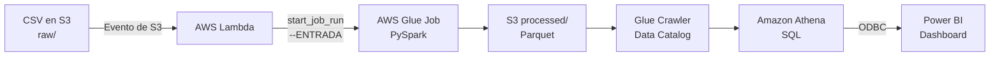
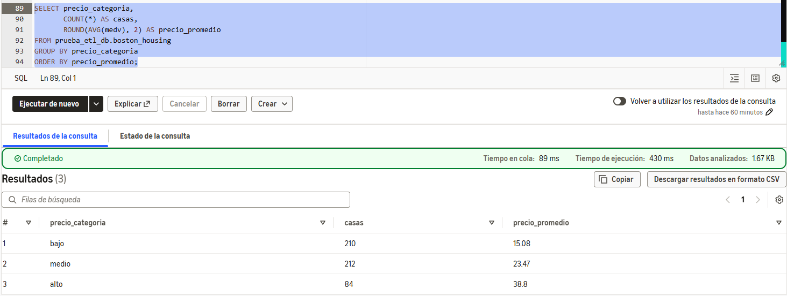
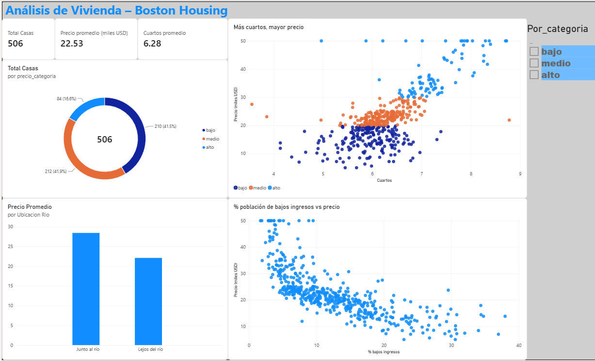

# Pipeline ETL serverless en AWS — Boston Housing

Pipeline de datos **automatizado y sin servidores** en AWS: al subir un archivo CSV a Amazon S3, una función Lambda dispara un job de AWS Glue (PySpark) que limpia y enriquece los datos, los guarda en formato Parquet, los registra en el Data Catalog y los deja listos para consultarse con SQL en Amazon Athena y visualizarse en un dashboard de Power BI.

## Arquitectura




| Capa | Servicio | Función |
|---|---|---|
| Almacenamiento | Amazon S3 | `raw/` (datos originales), `processed/` (Parquet), `athena-results/` |
| Orquestación | AWS Lambda | Detecta cada CSV nuevo en `raw/` e inicia el job de Glue |
| Transformación | AWS Glue (PySpark) | Extrae, limpia, enriquece y carga los datos |
| Catálogo | Glue Crawler + Data Catalog | Detecta el esquema y registra la tabla |
| Consulta | Amazon Athena | Consultas SQL directamente sobre S3 |
| Visualización | Power BI (ODBC) | Dashboard interactivo |
| Seguridad | AWS IAM | Roles y usuarios con permisos por servicio |

## Tecnologías

AWS S3 · AWS Glue · AWS Lambda · Amazon Athena · AWS IAM · Python · PySpark · SQL · Power BI · DAX

## Estructura del repositorio

```
etl-aws-boston-housing/
├── glue/etl_job.py              # Script del job de Glue (PySpark)
├── lambda/lambda_function.py    # Función que dispara el job al subir un CSV
├── sql/consultas_athena.sql     # Consultas de validación y análisis
├── powerbi/capturas/            # Capturas del dashboard y del pipeline
└── README.md
```

## Flujo del pipeline

1. **Extract:** se sube un CSV a `s3://<bucket>/raw/`.
2. **Disparo automático:** S3 genera un evento (prefijo `raw/`, sufijo `.csv`) que invoca a Lambda.
3. Lambda inicia el job de Glue y le pasa la ruta del archivo en el parámetro `--ENTRADA`.
4. **Transform** (Glue / PySpark):
   - Normaliza los nombres de columnas (minúsculas, sin espacios).
   - Elimina duplicados y registros con valores nulos.
   - Crea la columna `precio_categoria` según el valor medio de la vivienda (`medv`, en miles de USD):
     - `alto`: ≥ 30
     - `medio`: ≥ 20
     - `bajo`: < 20
5. **Load:** escribe el resultado en `s3://<bucket>/processed/boston_housing/` en formato **Parquet**.
6. Un **Glue Crawler** registra la tabla `boston_housing` en el Data Catalog.
7. **Athena** consulta la tabla con SQL y **Power BI** se conecta a Athena mediante el driver ODBC.

## Resultados

Consulta en Athena (`sql/consultas_athena.sql`):

| precio_categoria | casas | precio_promedio (miles USD) |
|---|---|---|
| bajo | 210 | 15.08 |
| medio | 212 | 23.47 |
| alto | 84 | 38.80 |



- 506 registros procesados (dataset completo, sin duplicados ni nulos).
- La consulta escaneó solo **1.66 KB** gracias al formato Parquet.

### Dashboard en Power BI

Indicadores: total de casas (506), precio promedio (22.53 miles USD) y cuartos promedio (6.28).

Visuales:
- Distribución de casas por categoría de precio.
- Relación entre número de cuartos (`rm`) y precio (`medv`).
- Relación entre % de población de bajos ingresos (`lstat`) y precio.
- Precio promedio según cercanía al río Charles (`chas`).
- Segmentador por categoría de precio.



## Retos y soluciones

| Reto | Diagnóstico y solución |
|---|---|
| La ruta de salida del job apuntaba a `raw/` con modo `overwrite`, lo que habría borrado el archivo original | Se separaron las capas `raw/` y `processed/` y se revisan las rutas antes de cada ejecución |
| Error `InvalidSignatureException` al conectar el driver ODBC | El Access Key era válido pero la Secret Key se copió mal; se corrigió desde el archivo original y se validó con el botón *Test* del DSN |
| El conector nativo de Athena en Power BI no autenticaba | Se usó el conector ODBC genérico apuntando al DSN ya probado |
| Dependencia circular al ordenar categorías en Power BI | La columna de orden se calculó a partir de `medv` en lugar de `precio_categoria` |

## Costos y optimización

- El job se ajustó de 10 a **2 workers (G.1X)** y el *timeout* de 480 a **10 minutos**.
- Cada ejecución cuesta **centavos de dólar**; Athena cobra por datos escaneados y Parquet reduce ese volumen.
- El bucket tiene **bloqueado todo el acceso público**; los servicios acceden mediante roles de IAM.

## Mejoras futuras

- Rol de Lambda con **mínimo privilegio** (solo `glue:StartJobRun` y logs).
- Alertas por correo ante fallos del job (Amazon SNS / EventBridge).
- Guardar históricos con modo `append` y **particiones por fecha de carga**.
- Orquestar job y crawler con Step Functions o Glue Workflows.
- Definir la infraestructura como código (CloudFormation o Terraform).

## Cómo reproducirlo

1. Crear un bucket S3 con las carpetas `raw/`, `processed/` y `athena-results/`.
2. Crear un rol de IAM para Glue con acceso a S3.
3. Crear el job de Glue con `glue/etl_job.py` y el parámetro `--ENTRADA`.
4. Crear la función Lambda con `lambda/lambda_function.py`, permiso `glue:StartJobRun` y un desencadenador de S3 (prefijo `raw/`, sufijo `.csv`).
5. Ejecutar un Glue Crawler sobre `processed/boston_housing/`.
6. Configurar Athena (ubicación de resultados) y conectar Power BI con el driver ODBC de Athena.

## Referencias

Amazon Web Services. (s.f.). *AWS Glue documentation*. Recuperado el 16 de noviembre de 2026, de https://docs.aws.amazon.com/glue/

Amazon Web Services. (s.f.). *Amazon Athena documentation*. Recuperado el 16 de noviembre de 2026, de https://docs.aws.amazon.com/athena/

Amazon Web Services. (s.f.). *AWS Lambda documentation*. Recuperado el 16 de noviembre de 2026, de https://docs.aws.amazon.com/lambda/

Harrison, D., & Rubinfeld, D. L. (1978). Hedonic housing prices and the demand for clean air. *Journal of Environmental Economics and Management, 5*(1), 81–102. https://doi.org/10.1016/0095-0696(78)90006-2

## Autor

**Juan Antonio Delgado Hinojosa** — [GitHub: AntonioEDIT](https://github.com/AntonioEDIT)
